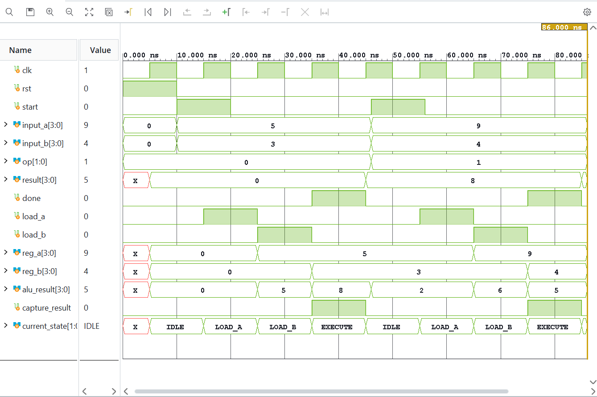
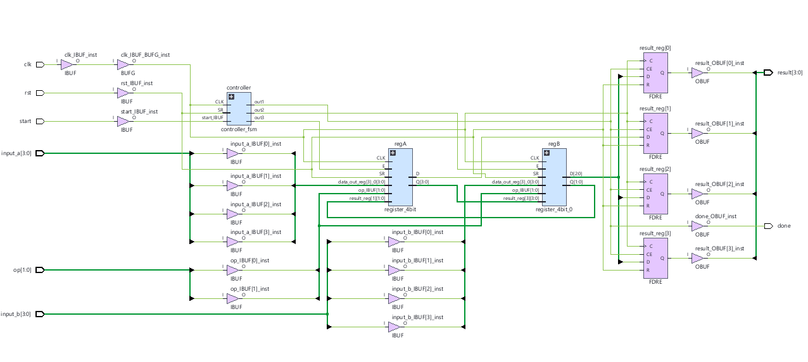

# FSM-Controlled 4-bit ALU Digital System

A SystemVerilog RTL design implementing an FSM-controlled datapath with
registered operands, a 4-operation ALU, and a registered result.

## Architecture

The design separates the control path from the datapath.

### Datapath
- 4-bit Register A
- 4-bit Register B
- 4-bit ALU
- Registered result output

### Controller
A finite-state machine sequences the datapath through:

IDLE → LOAD_A → LOAD_B → EXECUTE → IDLE

## ALU Operations

| Opcode | Operation |
|--------|-----------|
| 00 | ADD |
| 01 | SUBTRACT |
| 10 | AND |
| 11 | OR |

## Design Concepts

- SystemVerilog RTL
- Combinational logic using `always_comb`
- Sequential logic using `always_ff`
- Finite-state machine design
- Datapath/control-path separation
- Hierarchical RTL design
- Registered outputs
- Self-checking testbench

## Verification

A self-checking SystemVerilog testbench verifies:

- Addition
- Subtraction
- Bitwise AND
- Bitwise OR
- FSM sequencing
- Registered result behavior

## Synthesis

Synthesized using AMD Vivado targeting an Artix-7 FPGA.

Resource utilization:

- Slice LUTs: 8
- Slice Registers: 16
- Bonded I/O: 18
- BUFGCTRL: 1

## Simulation

## Synthesized Design

